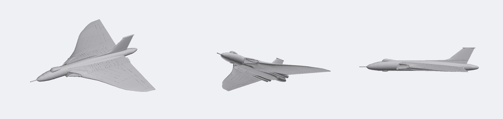
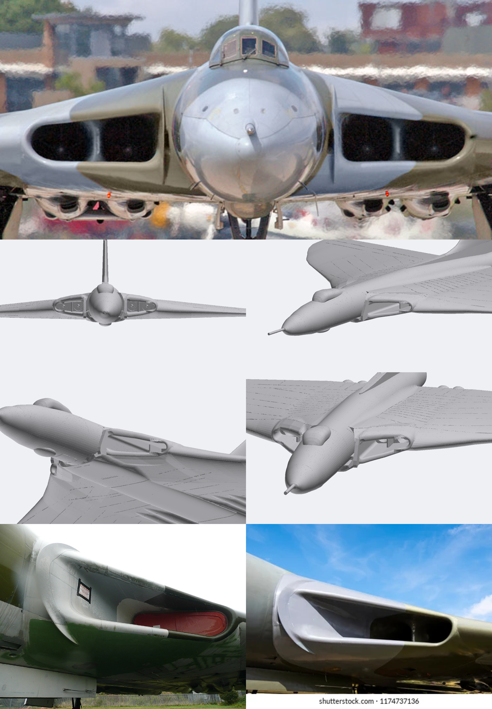
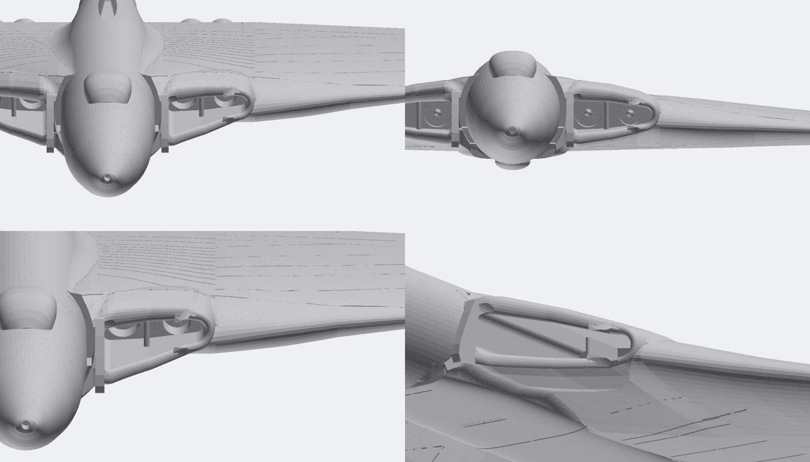
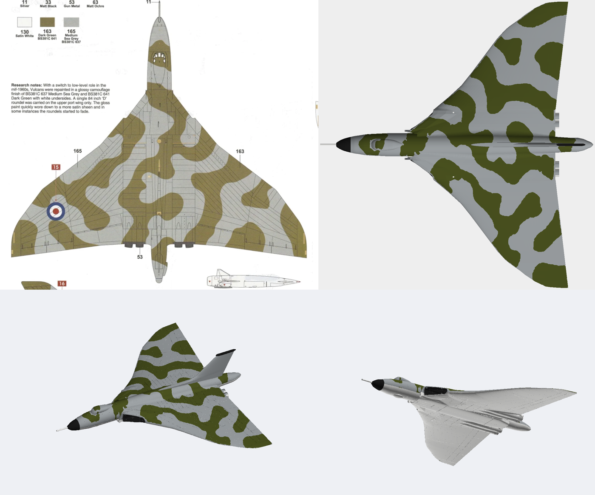

# Avro Vulcan B.2 snap kit

Avro Vulcan B.2 at 1:96: 352 mm span, 317 mm long (336 mm with the refuelling probe), about the span of a 1:32 Spitfire. To be a fully printed, multi-colour snap kit like the Halifax and the Hawk.

## Brief (agreed 2026-11-13)

- **Scale:** 1:96, chosen for a span close to the user's 1:32 Spitfire kit (351 mm if that kit is 1:32: its file is not in this repo, so the figure is from the real span, 11.23 m). The shape is built at 1:72 (`SCALE`) and scaled by `PRINT_K` 0.75 on output.
- **Print files:** anti-flash white (Airfix scheme B: XM602, No. 12 Squadron, 1963), and camouflage on top with a plain underside (Airfix scheme A: XM594, Scampton, 1966: grey and green over white). Camouflage wrapped round the underside (as XH558 flew) is an option: alternative lower shells.
- **Display:** stand with the wheels up, and gear down, both in the kit; a bomb bay that can be built open, and a Blue Steel missile option (user, confirmed).
- **For MakerWorld:** a single-colour version for printers without an AMS; plates that fit 256 mm beds; no supports, no glue.



> **Status: v34: shape fitted to the Airfix A12011 plan and side views and refined through user review; split into 61 parts with joints, bays, gear, stand, Blue Steel and a camouflage colour pass with canopy glazing.** Nothing has been printed or sliced yet.

Intakes (v22, user: "the spline shape is an important detail to get right"). The mouth is one outline measured on two head-on photos: tall at its inner end (z -5.3 to 8.2 at y 23.8, a nearly upright inner edge with rounded corners), tapering through gently bowed lips to a round outer end at y 56 (`INTAKE_INNER`, `INTAKE_OUTER`, `INTAKE_BOW`; `mouth_outline` builds it as a convex hull with rounded corners, 144 points). The lip is a half-round whose thickness varies round the mouth (`lip_t`): a heavy brow on top, 6.2 mm at the fuselage end thinning to 3.2 outboard (4.65 to 2.4 printed), a lighter lower lip (4.4 to 2.8), 2.5 at the outer end. In plan it follows the wing's leading edge, so the notch at y 50-58 is its outer end. The inner wall is a separate hooked plate, 2.2 mm thick, standing 2.7 mm off the fuselage with an open slot behind it: its leading edge runs forward and down from the upper lip to a horn below and 8.6 mm ahead of the lower lip, then hooks back under it (`INTAKE_HORN`, `intake_horn`; photos of the blanked intake and the lip close-up). Behind the lip the fairing carries its shoulders 70 mm back into the wing (`INTAKE_FAIR`).

Two things moved to make the intakes printable. The centre body / wing joint is at y 59, outboard of the lip (at 57 it cut the lip's outer end). The split between upper and lower shells is at z -2.6, just above the highest point of the mouths' floor, so the whole lower lip and duct floor are in the lower shell (at -4 the upper shell carried a feather-thin sheet of duct floor, which came loose). The cost: in the lower centre shell, printed turned over, the duct floors are ceilings 1.5 to 2 mm above the bed, bridged between the duct walls, and the duct roofs in the upper shell are bridges too. Both are inside the ducts and will be black, but look at them on the first print. Top: photo; middle: model; bottom: photos of the inner plate and the lip.



Rear fuselage (v9, user review against the XH558 Farnborough photo and the Airfix top view): the body tapers and its top falls away from x 225 (1:72), under a long dorsal ridge that is part of the fin and keeps the top line level (`FIN_RIDGE`); the fin so starts 80 mm further forward than its main leading edge. The jet pipes sit across the trailing edge (`JET_Z`), so their tops show as humps on the upper surface over the last 40 mm.

Smooth upper surface (v10, user: "seamlessly incorporating the engines"): every concave crease on top over the engines, and underneath round the jet pipe fairings, is filled as if a ball had been rolled over it (`surface_blend`: a height field of the surface, closed with a 12 mm ball along the fuselage, 4 mm by the intakes and underneath, fading out at the trailing edge). The intake fairing now ends 45 mm behind the lip, under the wing's own crest, and the inboard thickness follows a smooth curve into the outer wing. Sections before (black) and after (red):


Panel lines (v11): the upper surface carries the main lines from the Airfix scheme B top view, read on a 10 mm grid (`PANEL_LINES`, `HINGE_LINES` in `vulcan.py`): the engine bay panels, the leading-edge and rear spar lines, the outer wing joint, every other skin stiffener, the jet pipe panels, and the elevon hinge and ends (deeper). 0.5 mm wide and 0.25 mm deep as printed (hinges 0.6 x 0.4). Underneath (v12, from the scheme B underside view; `UNDER_LINES`, `UNDER_DOORS`, `UNDER_STBD`): the engine doors, crew hatch, the outer wing's lines as on top, the plate under the starboard jet pipes, and, cut deeper, the bomb bay doors (123 x 43 mm at 1:72, x 187 to 310), the nose gear doors and the main gear doors. Still to do: the fuselage and fin, airbrakes.


Bays and belly (v13): the bomb bay (92 x 32 mm printed), nose gear bay and both main gear bays are cut into the lower shells, each with a ledge; a door panel cut from the shell's own skin drops in from below (`door_bomb`, `door_nose`, `door_main_stbd/port`), or is left out for an open bay. A ribbed roof plate (`bomb_bay_roof`) is trapped between the centre shells. Fitting the bomb doors showed the belly was wrong: under the wing the body is a flat-bottomed keel, not a tube (`KEEL_STATIONS`). The inboard underside now comes up to the intake's lower lip on a long ramp (`WING_UNDER_RAMP`). Top: bays open; bottom: door panels fitted.


Landing gear (v14): nose leg with twin wheels, and two main legs with eight-wheel bogies, drag braces and shock struts, from the Airfix side view on a 5 mm grid, the instruction pages and photos. Each leg is two flat halves split on its centre plane (`*_gear_*_a/b`), printed lying on that plane with the wheels moulded on top (no loose axles; flares and tyre grooves at 45 degrees, so no overhang). The halves' top ends form one plug, pushed up through the bay roof into a socket that runs on into the upper shell. For gear down, each bay takes a frame that sits on the ledge with the open doors standing from it (`doors_open_nose`, `doors_open_main_*`) in place of the closed door panel. Ground line z -46.5 (1:72): the belly is 23.6 mm off the table as printed. Legs are thicker than scale (3.3 mm printed).


Blue Steel (v15): the stand-off missile from the Airfix scheme A sheet (149 mm long at 1:72, 112 mm printed), carried half sunk in the bomb bay with its nose 21 mm ahead of the bay. The kit part (`blue_steel`) is the half below the belly, printed on its flat top face with the wings and foreplanes on the bed; two keys on its own bomb door panel (`door_bluesteel`, fitted in place of `door_bomb`) hold it. The centreline is put on the belly line so the part prints flat: the real missile sat slightly lower. The top fin (inside the bay) and the folded lower fin are left off.


Stand (v16): a blade post (`stand_post`, printed flat) with a 6 mm square key that goes up through its own bomb door panel (`door_bomb_stand`) into the bay roof plate, and a tenon into a 150 x 100 x 8 mm plinth (`stand_base`). The aircraft sits 8 degrees nose-up, belly 80 mm above the plinth. The plain `door_bomb` has no hole. Not yet possible: the stand together with the Blue Steel.


Interference check (`common/tools/interference.py`, gear down with the Blue Steel, keys left out): clean.

Joints (v17, untested: print coupons before trusting any fit). Every key is a 3 mm plate standing on edge across the split surface, upright in the assembled frame, so the keys go into the lower shells and every upper shell drops straight down onto them (`KEYS`, `add_joints`). 26 keys in 7 sizes: 20 short ones (6 mm long, 3.2 to 10 mm tall, the height found from the material at each place) between upper and lower shells, 2 of 18 mm across the front/centre joint and 4 spars of 30 mm across the wing joints. The radome pushes onto a tongue moulded half on each front shell; the probe (2 mm, thicker than scale) plugs into the radome tip; the fin is two halves printed on their split faces, its root in a slot of its own shape. Checks: no overlaps between parts, every part one piece. Not keyed yet: the wing shells outboard of y 150 (too thin for a key: the tips may need a lip), and the two fin halves to each other above the slot.

Engine faces (v20, user: "like you can see the engines if you look in the intakes"; silver pieces fitted at assembly). Each duct ends in a round tunnel (8.25 mm bore printed) with a compressor face at its end: a hub cone and 10 swirled blades in relief on a small plate (`engine_face_*`, 4 of them, 11 x 10 x 3 mm), printed face up and dropped into a slot between the centre shells. All four faces are at the same station, x 192 at 1:72 (user review: further back, and the same distance from the nose), so the inner ducts are 70 mm long at the fuselage side; the wall between the two ducts starts 24 mm behind the lip (`ENGINES`, `ENGINE_FAN`, `INTAKE_SPLIT`). The long duct roofs print as bridges up to 24 mm wide in the upper shell: hidden, but check them on the first print. Left: from slightly above; right: straight in.


Tidy-up (v24, user: "this part looks wonky", pointing at the outer end of an intake and the leading edge beside it). Three causes, all fixed: a sawtooth strip along the leading edge and ragged slivers on the lips, both from the surface smoothing (its fill is now clipped to the planform, made on a finer grid, 0.75 mm in x, and kept only where a crease deeper than 0.2 mm is really being filled: `BLEND_STEP`, `BLEND_MIN`); and the outer engine's round tunnel breaking through its duct's roof and floor (each tunnel now has its own radius, 5.5 and 4.5: `ENGINES`).



Integrated intakes (v25, user review with three marked-up renders: the intakes read as separate pieces on a thin wing, with an obvious lip; the wing's top line too high; the underside junction with the fuselage not smooth). Across the intakes the wing's leading edge is now the lip itself: each wing section from y 21 to 59 starts on the lip's outer surface (`lip_envelope`), holds the lip's height behind its nose and lets it go over 70 mm on top and 110 mm underneath (`WING_NOSE_HOLD`), so the upper surface runs out of the top lip and the underside out of the bottom lip with no rim or shelf. The separate fairing behind the lip is reduced to a short tail buried in the wing. The wing's top line at the root is 3.4 mm lower (`WING_ROOT_UP`), the top lip thinner (5 to 3 mm), the lip line's kink at the leading-edge notch rounded, and the underside fillet between wing and fuselage ahead of the gear bays widened to a 14 mm ball (`BLEND_UNDER_R`). The image above shows this version.

Level lower lip (v26, user review: "From the front on view, it's as if they are rotated slightly up. The bottom edge should be horizontal and the top should slope down gently"). The mouth's lower lip now runs level at z -5.3 from the inner edge to the outer end (it used to rise 3.4 mm outboard); only the top slopes down, from 8.2 to 3.5. The outer end is a larger, blunter round (radius 4.4, centre y 51.6, z -0.9), and the engines are recentred in the lowered ducts (z 1.0 and 0.0). `render.py` has a `head0` view (exactly head-on) for judging this, and takes any view direction as `dx:dy:dz`.

Thin lip (v27, user's photos: XJ824 intake close-up, a stock close-up, air-to-air views from above and below). The lip is a thin, even rolled edge with the wing flaring out round it, not a heavy brow: top 3.2 to 2.4 mm, bottom 2.8 to 2.2, 2.0 at the outer end (2.4 to 1.5 mm printed). Because the wing sections start on the lip, the wing now closes in tighter round the mouth.

Intakes cut from the wing (v28, user: "start with a wing shape that flows neatly into the fuselage, then treat the intakes as a cut away of the front of the wing"; "the fence inboard of the intake isn't right, neither is the way the ring joins the fuselage at the leading edge"). The separate lip loft, its fairing and the hooked plate are gone. The wing's root now has a blunt nose (`wing_nose`): quarter-ellipse caps above and below the leading edge, as tall as the mouth plus a margin, merged into the wing's own surfaces with a smooth maximum (no creases), with the crest brought forward (`WING_CREST` 0.06 of the chord) for the blunt shoulder over the mouth seen head-on. The mouth is then cut straight back into that nose (`intake_cut_rings`): for each point of the outline the cut finds where the nose surface is, rounds the edge there (1.4 mm, 0.6 on the inner wall) and runs back to the engine tunnels, so the lip is the wing's own skin and the mouth's edge sits further back at the top than the bottom, as in the Airfix side view. Inboard, a 2 mm plate with a half-round edge stands off the fuselage across a full-height gap (`intake_plate`, `INTAKE_C`): a C in side view, furthest forward at mid-height (x 113.6), its top running back into the shoulder, its foot a horn below the lower lip (Airfix side view at the root; head-on and blanked-intake photos). Image: `docs/intake_cutaway.png` (Airfix side, head-on photo, blanked intake; model beside each).

Fence, mouth shape and lip (v29, user: "fence is too pronounced; if the fence wasn't there the wing should seamlessly join the fuselage"; "more trapezoidal with the outboard side curved, not pentagonal"; "there should be a thickness to the top and bottom of the intake"). The full-height gap is gone and the wing root runs straight into the fuselage. The fence is now a 1.8 mm rim with a half-round edge, standing 0.9 mm proud of the wing's nose at the mouth's inner edge and running 12 mm back (`INTAKE_FENCE`). The mouth's outline has no mid-span point any more: upright inner edge, level bottom, straight top sloping down, round outer end. The nose reaches further above and below the mouth (`INTAKE_LIP_TOP` 4.2 to 3.2, `INTAKE_LIP_BOT` 4.8 to 3.2) and the cut's edge is rounded at 2.2 mm, so the top and bottom read as thick rolled lips. The outer engine face is a little lower and smaller (z -0.4, radius 4.2) to stay inside the straighter top. Image: `docs/intake_v29.png`.

Flat underside (v30, user: "underside of wing looks scalloped; it should be much flatter and merge neatly into the fuselage; there are flat edges at the wing root on the fuselage, like shoulders"). Inboard, the wing's underside followed the aerofoil and touched the flat bottom only near 30% of the chord, while the flat-sided keel under the fuselage ran at full depth from the nose bay to the tail, so the keel stood proud as shoulders with a trough beside it. Now the inboard underside comes down from the lower lip over the first 10% of the chord (`WING_UNDER_RAMP`), stays flat, level with the keel, and rises to the trailing edge over the last 14% (`WING_UNDER_TE`); outboard it still fades into the aerofoil. The keel narrows aft (`KEEL_STATIONS`) where the wing rises to its trailing edge. The jet-pipe fairings, which the flatter underside had half buried, get a fairing below each pipe (`JET_UNDER`: the pipe's profile dropped 3.5 mm, meeting the nozzle), so they hang below the wing from mid-chord as before; the tops and nozzles are unchanged. Image: `docs/underside_flat.png`.

Wing root under the intakes (v31, user markup of the area below the intakes' inner ends). The flat-sided keel started abruptly at x 116, already 17 mm wide, so its square corner stood below the round fuselage ahead of where the wing's underside comes down to the flat: a wedge and a shelf under each intake. The keel now starts 9.5 mm wide at x 112 and widens only as the wing's underside reaches it (`KEEL_STATIONS`: 11.5 at 118, 14 at 135, 19 at 150, full 22.5 from 165), and the underside fillet ahead of the bays is 9 to 10 mm (`BLEND_UNDER_R`). The fence stops at the lower lip (`INTAKE_FENCE_Z`): below it, it read as a jagged hook. Image: `docs/root_underside.png`.

The same at the back (v31, user markup between the fuselage and the inner jet pipes): the keel stayed 16.5 to 11 mm wide right to the trailing edge, wider than the round rear fuselage, so its flat sides stood as walls where the wing's underside rises to the trailing edge. It now narrows from the end of the bomb bay (22.5 at x 312, 17 at 324, 11 at 336, 7 at 348, 5 at 356) inside the fuselage's own section, and the wing's underside rises to the trailing edge over the last 11% of the chord (`WING_UNDER_TE`), with a 5 to 6 mm fillet there (`BLEND_UNDER_R`). Image: `docs/rear_underside.png`.

Canopy (v32, user: "canopy angle at fuselage join is too steep, should look shallower"; head-on photo). The canopy was a narrow dome whose sides stood nearly upright on the fuselage. It is now a trapezoid: a flat-topped superellipse (`CANOPY_N` 3), its width scaled from 1.4 times the station half-widths at the bottom to half that at the top (`CANOPY_WIDEN`, `CANOPY_TAPER`), with the section's widest point sunk inside the fuselage (`CANOPY_DEPTH` 18), so straight sloping sides meet the fuselage at about two-thirds of its width, as in the photo. A fillet from the surface blend was tried first and left a ragged fringe on the curved nose. Image: `docs/canopy.png`.

Canopy glazing (v33, colour; canopy side photo and head-on photo; user review). The canopy is metal with small windows, painted black into its skin with the frames left in the camouflage colours (`glazing` in `colour.py`). Three four-sided windscreen panels on the sloping front: seen head-on a rectangular centre panel and a trapezoid each side whose outer edge follows the canopy's slope, 0.9 mm frames between them (0.7 printed) (`GLAZE_SCREEN`); a triangular side window just behind each side panel, its front edge one frame behind the panel's rear edge (`GLAZE_SIDE`); a round porthole on each side further back (`GLAZE_PORT`). Black is already on the upper-centre plate (the ducts), so it costs no extra colour. The renderer shows ragged edges on the windscreen where the thin black layer meets the surface; sections through the painted part show clean outlines. Image: `docs/canopy_glazing.png`.

Canopy rake and portholes (v33, user review against the side photo). The windscreen now rises at about 29 degrees from x 58 to 68 and rounds over to the top at x 74.5 (`CANOPY_STATIONS`); it was 38 to 52 degrees and peaked by x 70. The windows moved with it. Each porthole is a circle facing 42 degrees above the horizon (`GLAZE_PORT`): seen from the side it is an ellipse 0.74 as tall as wide, as in the photo.

Canopy against the Airfix drawings (v34, user: the windows sat too far above the fuselage head-on). The canopy now starts at x 51.5 as in the Airfix side view (it started at 56) and rakes at about 33 degrees to the top at x 70. The windscreen's bottom frame is just above the fuselage (z 21.4; the canopy meets the fuselage at about z 20.3), the panels start at x 56 (`GLAZE_SCREEN_X`; Airfix top view: 58), the triangles sit below and behind the side panels at x 63.7 to 68.3, and the portholes are at x 71.5. Image: `docs/canopy_glazing.png` (photo, Airfix side and top views on a 2 mm grid; model head-on, side, top).

Window shapes (v34, user: "not the shape of the windows"; head-on photo at 12.1 px per model mm): the centre panel is an upright rectangle (3 x 3.7 mm at 1:72), and each side panel a parallelogram with upright inner and outer edges whose top and bottom slope down outboard, 1.5 mm out from the centre pane (heavy frames). The triangles moved forward to sit one frame behind them, in line with them: bottom and top level with the side panels' outer corners, front edge parallel (user: "they look like they've been designed separately"). The portholes are at x 68.8.

Markings (v34, colour; Airfix A12011 scheme A, XM594 at Scampton, 1966). Camouflage on the sides now comes from the side view (`vulcan/tools/trace_camo_side.py` traces `camo_xm594_side.json`: the green areas and the line where the upper colours meet the white): used on the nose sides (x < 112, below z 13), the tail cone and the fin, so on the nose it runs below the shell split, onto the lower shell, as on the aircraft. One 84-inch Type D roundel (red : white : blue diameters 1 : 2 : 3) on the upper port wing only, as the Airfix notes say, and one 54-inch on each side of the nose. Fin: red, white and blue flash (red leading on both sides) and the serial XM594 (read correctly from each side). Tyres black on the silver gear. Two filaments added, Roundel Red and Roundel Blue; the canopy glazing and the serial are in Roundel Blue (a very dark blue), so every plate stays at five colours or fewer: the front shells now share the wing plates (front upper with the port wing, which carries the other roundel). The starboard fin shows the port side's pattern mirrored (the sheet only shows the port side). The fin cap is camouflaged, as on the sheet (it was black). Image: `docs/markings_camo.png`.

Intake colours (v34, user review against the head-on photo: the black read too large, the camouflage should come further forward round the intakes). The black inside the ducts now starts 10 mm behind the end of the lips' rounding (`LIP_CLEAR`), so the lips and the mouth of each duct are in the surface colours and only the depths are dark. On the lower shells the intakes' lower lips, down to z -11.5, are in the upper colours with the side view's green (`INTAKE_ZONE`, `INTAKE_LIP_Z`): the white starts below them, as in the photo and the Airfix side view. Image: `docs/intake_colour.png`.

## Colour (v23: first pass)

`vulcan/cad/colour.py OUT [camo|white]` paints each part into per-filament volumes and writes the STLs, a preview (`vulcan_<scheme>_preview.glb`) and the Bambu Studio project (`vulcan/kit/vulcan_camo_kit.3mf`). About 20 s.

- **Camouflage (XM594, 1966):** Medium Sea Grey upper shells with the Dark Green areas painted 0.8 mm deep into the upper and side skin. The pattern is traced from the Airfix scheme A top view by `vulcan/tools/trace_camo.py` into `vulcan/tools/camo_xm594_top.json` (10 outlines; the build reads the JSON, not the image). The skin is measured on the whole assembled aircraft, so joint faces, slots and bays stay plain.
- **Underside:** white lower shells, doors, bay roof and Blue Steel. Because of the shell split there is no colour change on any lower part except the black ducts.
- **Black:** radome, fin cap, the intake ducts and jet pipe bores, the stand. **Silver:** engine faces and gear.
- **Plates (9, at most 3 colours each):** upper centre and front (grey, green, black); each upper wing (grey, green); fin (grey, black); lower centre and front (white, black); each lower wing (white); black and silver parts; white small parts and keys.
- **Not yet:** roundels (upper port wing, nose sides), fin flash, serial, squadron badge, the fin's own camouflage (plain grey so far), black tyres, the white scheme's pale markings. The camouflage ends at the split between the shells; on the real aircraft it runs a little lower on the nose. The project file has not been sliced (no Bambu Studio in the cloud session): prime tower positions and nozzle reach are unchecked.

Left: the Airfix sheet; right: the model from above; below: 3/4 views.



## Parts (v6: first split, no joints yet)

Upper and lower shells, as in a plastic kit, so every underside part prints in one colour and both skins print as top layers. The split surface holds the wing's leading and trailing edges: level at z -2.6 (1:72) across the centre body, then a plane falling 3.7 degrees to the tip on each outer wing. Upper shells print standing on the split face; lower shells are turned over onto it.


61 parts in all, 26 of them keys (`out/.../print/`, each in its print pose at printed size):

| Part | Printed size (mm) |
|---|---|
| `radome` (on end) | 18 x 19 x 18 |
| `front_upper`, `front_lower` | 61 x 28 x 25, 61 x 26 x 11 |
| `centre_upper`, `centre_lower` | 238 x 86 x 22, 238 x 86 x 8 |
| `wing_stbd_upper/lower`, `wing_port_upper/lower` | 165 x 134 x 9, 165 x 134 x 8 |
| `bomb_bay_roof` | 95 x 35 x 2.6 |
| `door_bomb`, `door_bomb_stand`, `door_bluesteel` (one of) | 92 x 32 x 2 to 3.8 |
| `blue_steel` | 112 x 39 x 6.6 |
| `door_nose`, `door_main_stbd/port` (wheels up) or `doors_open_nose`, `doors_open_main_stbd/port` (gear down) | up to 40 x 11 x 12 |
| `nose_gear_a/b`, `main_gear_stbd_a/b`, `main_gear_port_a/b` | 10 x 36 x 4, 16 x 36 x 6 |
| `stand_post`, `stand_base` | 34 x 95 x 6, 150 x 100 x 8 |
| `fin_stbd`, `fin_port`, `probe`, 26 `key_*` | 141 x 51 x 3; 25 x 2 x 2 |

All fit a 230 x 250 mm plate. Overhangs: none on the wings, doors, gear, stand, roof or front shells; `centre_upper` (intake duct roofs) and `centre_lower` (jet pipe bores, bay ledges) still have some.

Still to do on the split: test coupons for every joint, separate jet nozzles, the stand with the Blue Steel fitted, something to hold the wing tips' shells together.

## Build

```bash
.venv/bin/python vulcan/cad/vulcan.py out/vulcan/NAME        # about 10 s
.venv/bin/python common/tools/ref_overlay.py out/vulcan/NAME/assembled plan OUT.png --refs vulcan/tools/refs.json   # also: side, front
.venv/bin/python common/tools/render.py out/vulcan/NAME/assembled OUT.png --views high34,lowfront,highrear --zoom 1.5
```

`vulcan/cad/vulcan.py` holds the shape as station tables. Lofts are ruled point rings built straight in manifold3d (`ring_loft`); CadQuery is not used.

## Shape and references

- **Main drawings:** the Airfix A12011 painting guide, scheme A (XM594, Scampton 1966): flat upper plan, underside plan and both side views, with panel lines, at about 0.97 mm per pixel at 1:72 (a screenshot; a sharper copy would help). Calibrated in `tools/refs.json` as `plan` and `side`. The outline sits on both.
- **Sharper views (2026-11-14, user uploads, in `ref/vulcan/`):** each Airfix view as its own zoomed screenshot, about 0.44 mm per pixel at 1:72: `airfix_a_top`, `airfix_a_side_port`, `airfix_a_under_bluesteel` (with the Blue Steel's side and plan views), `airfix_b_top`, `airfix_b_side_stbd`, `airfix_b_under`. `plan` and `side` in `tools/refs.json` now point at the scheme A ones; the first screenshots are `plan_lo` and `side_lo`. Also Airfix instruction pages 22-23 (main gear: leg, bogie with 8 wheels, doors, bay), a side-on photo of the canopy and nose roundel, a photo of a main gear bogie, the nose gear side-on at take-off, a colour head-on photo on the ground (intakes, splitter plates, all three gear legs) and two photos of the open bomb bay.
- **Other sources:** the Commons silhouette (`sil_plan`, `sil_front`; sharper, 0.51 mm per pixel, and its wing agrees within about 3 mm, but its tail cone is 17 mm short) and the aerospaceweb.org 3-view (`aw_plan`).
- **Length:** 422.5 mm at 1:72 from nose tip to tail cone: the published 99 ft 11 in (30.45 m), without the probe. With the probe 448.5 mm (32.3 m; published 105 ft 6 in).
- **Check:** the model's wing area is 367.4 m², against the real 368.3 m².
- **Photos (in `ref/vulcan/`, not in git):** XH558 from below with the bomb bay open (camouflage wraps round the underside), a head-on photo from 1982 (intakes, nose, probe), a top view of a camouflaged Vulcan on a runway (2024, airframe not identified), a straight-down top view (watermarked stock photo: measure only, mind the watermarks when tracing), a top-view camouflage illustration, a wrapped-camouflage underside in flight, XH558's nose and intakes (roundel, badge, lettering, nose gear), XH558's fin (fin flash without white, Union flag, shield, serial, fin cap, jet pipes), and model photos from aircraftinplastic.com.
- The trailing edge is the outermost line of a plan view. The line inboard of it is the elevon hinge line.

## Known gaps and next steps

Markings and colour:
1. Small stencils (the rescue arrow, walkway lines) if they print legibly; a squadron badge if a reference turns up (the Airfix sheet shows none for XM594).
4. The anti-flash white scheme (XM602) with its pale markings; the optional wrapped-camouflage lower shells; a single-colour version.

Detail:
5. Panel lines on the fuselage and fin; the airbrakes.

Kit and printing:
6. Test coupons for every joint (keys, tongues, gear plugs, engine-face slots, stand key), printed before the full kit.
7. Keys or a lip for the outer wing shells outboard of y 150 and for the fin halves above the slot.
8. The stand with the Blue Steel fitted (they use the same bomb door panel today).
9. Bridges and overhangs in the centre shells (duct roofs and floors, bay ledges, jet bores).
10. Slice every plate in Bambu Studio (prime tower, nozzle reach, supports): not possible in the cloud session.
11. MakerWorld listing: hero renders, an assembly guide, the print settings.
